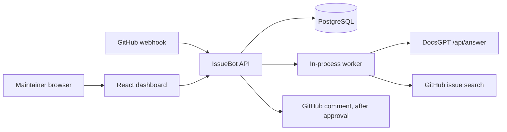

# IssueBot

IssueBot investigates a newly opened GitHub issue against a DocsGPT knowledge base and keeps the result for a maintainer to review. It does not post a GitHub comment unless a signed-in maintainer approves that exact comment.

Maintainers lose time reconstructing the same setup and documentation answers. IssueBot keeps the issue, the retrieved sources, and the model's hypotheses in one case file so a person can decide what is documented and what is still a guess.

## Capabilities

- Verifies GitHub webhook signatures and stores each delivery id once.
- Queues an investigation in PostgreSQL and processes it with an in-process worker.
- Calls DocsGPT `POST /api/answer`. The API key selects the agent.
- Labels documented facts, historical evidence, hypotheses, and unknowns separately.
- Shows only source URLs returned by DocsGPT. Model-written URLs are not stored as sources.
- Publishes a GitHub comment only after an authenticated person checks the preview and confirms the target repository and issue.
- Includes a demo mode that uses fixtures and never calls GitHub to publish.

## Limitations

- Live DocsGPT and live GitHub calls were not exercised with real credentials in this environment. The clients follow the contracts checked on 2026-10-10, and tests use mocked HTTP.
- DocsGPT does not attach a source to each sentence. Facts are kept only when the answer has a sources array, and the report says the sources apply to the answer as a whole.
- Similar-issue search uses GitHub Search. A search failure is recorded and does not fail the investigation. A match is not a duplicate verdict.
- Prompt injection in an issue body is contained by delimiters and by ignoring instructions in that text. That is not a guarantee that a model will ignore them.
- One local administrator. There is no multi-user role system.
- No license has been selected for this repository.

Screenshots are not included. Capture them from a running demo after sign-in: Overview, an investigation detail page, and Settings with secrets hidden.

## Architecture



The browser never receives API keys, the GitHub private key, the webhook secret, or installation tokens. See [docs/architecture.md](docs/architecture.md).

## Stack

Python 3.12, FastAPI, Pydantic v2, SQLAlchemy 2, Alembic, PostgreSQL 16, httpx. React 19, TypeScript, Vite, Tailwind CSS 4. Docker Compose. No Redis.

## Prerequisites

- Docker and Docker Compose, for the supported local run.
- Or Python 3.12+ and Node.js 22, for tests and the Vite dev server.

## Start with Docker Compose

```bash
cp .env.example .env
```

Edit `.env` before the first start:

1. Set `ISSUEBOT_ADMIN_PASSWORD` to at least 12 characters.
2. Set `ISSUEBOT_DB_PASSWORD` and use the same password in `ISSUEBOT_DATABASE_URL`.
3. Generate a Fernet key and set `ISSUEBOT_FERNET_KEY`:

```bash
python3 -c "from cryptography.fernet import Fernet; print(Fernet.generate_key().decode())"
```

Then:

```bash
docker compose up --build
```

Open `http://127.0.0.1:8080`. PostgreSQL is only on the Compose network. The API is not published to the host. The web container proxies `/api` to it.

The API runs Alembic `upgrade head` on startup. A second replica would race on migrations, so run one API container.

## First administrator

The first boot creates one user from `ISSUEBOT_ADMIN_USERNAME` (default `admin`) and `ISSUEBOT_ADMIN_PASSWORD`. There is no default password in the image. Change it under Settings after sign-in. Sessions last 12 hours. A cookie named `issuebot_session` is HttpOnly and SameSite=Lax. It is marked Secure when `ISSUEBOT_PUBLIC_BASE_URL` is `https`. Mutations also require the header `X-IssueBot-Request: 1`.

## DocsGPT

Official reference checked on 2026-10-10: [DocsGPT Agent API](https://docs.docsgpt.cloud/API/agent-api).

1. Create an agent in DocsGPT and copy its API key. The key selects the agent. IssueBot stores an agent id for display and does not send it beside the key.
2. Put the origin in Settings or `ISSUEBOT_DOCSGPT_BASE_URL`, for example `https://gptcloud.arc53.com`. No path.
3. Save the API key in Settings. The field stays empty after save and the page shows Configured.
4. Use Test DocsGPT. A successful test reports that DocsGPT responded and how many sources came back. It does not show the key.

In production, `http` DocsGPT URLs and private or loopback addresses are rejected unless `ISSUEBOT_ALLOW_PRIVATE_DOCSGPT=true`. Link-local and metadata addresses stay blocked.

## GitHub App

Checked on 2026-10-10 against GitHub's webhook, App JWT, and REST docs.

1. Create a GitHub App. Webhook URL: `{ISSUEBOT_PUBLIC_BASE_URL}/api/v1/webhooks/github`.
2. Set a webhook secret and save the same value in IssueBot.
3. Permissions: Issues read and write. Metadata is included automatically. Do not grant Contents or Pull requests.
4. Subscribe to Issues and Installation.
5. Generate a private key. Paste the PEM in Settings or set `ISSUEBOT_GITHUB_PRIVATE_KEY_PATH` to a file outside the repository. Do not commit the PEM.
6. Install the app on the repositories you want. Put those repositories in the allowlist as `owner/name`. An empty allowlist denies every repository.
7. Use Test GitHub. It calls `GET /app` and reports the app name. It does not print the private key.

IssueBot signs an App JWT (`iss` is the app id, `iat` is 60 seconds in the past, `exp` is 8 minutes ahead) and exchanges it at `POST /app/installations/{id}/access_tokens`. Tokens stay in process memory. Comment creation asks for `issues: write` on that repository id. Reads ask for `issues: read`.

### Local tunnels

GitHub must reach the webhook. A tunnel such as cloudflared or ngrok can forward to `127.0.0.1:8080`. Treat the tunnel hostname as public: use a long webhook secret, keep the allowlist tight, and close the tunnel when you are done. Do not point a tunnel at a machine that holds unrelated credentials.

## Environment variables

Every variable is prefixed with `ISSUEBOT_`. The full table, defaults, and rotation steps are in [docs/configuration.md](docs/configuration.md). `.env.example` contains placeholders only.

## Database

Migrations run on API startup. To run them yourself:

```bash
cd apps/api
alembic upgrade head
```

Resetting deletes investigations, sessions, and encrypted settings. Stop the API first. This destroys data:

```bash
docker compose down
docker volume rm issuebot_issuebot-pg
```

The volume name can differ. Check `docker volume ls` before removing anything.

## Tests and development

```bash
python3 -m venv .venv
.venv/bin/pip install -e "apps/api[dev]"
cd apps/web && npm ci
make test
make lint
```

Frontend dev server, with the API already on port 8000:

```bash
cd apps/web && npm run dev
```

Demo mode without Docker, using SQLite and fixtures:

```bash
export ISSUEBOT_ADMIN_PASSWORD='replace-with-12-plus-characters'
make demo
```

In another terminal, `cd apps/web && npm run dev`. The API banner and Settings both say that demo data is not published.

## Investigation workflow

1. GitHub sends `issues` / `opened`.
2. IssueBot checks `X-Hub-Signature-256` over the raw body, then records `X-GitHub-Delivery`.
3. If the repository is allowlisted and the installation is active, it stores the issue and a job in one transaction.
4. The worker claims the job, fetches the issue, asks DocsGPT, and optionally searches related issues.
5. The report is saved. Nothing is posted to GitHub.
6. A maintainer opens the investigation, reads the preview, checks the review box, and publishes.
7. IssueBot writes a publish row, looks for an existing marker comment, then creates the comment once.

## Reviewing a comment

Open the investigation. The preview shows the target `owner/name#number` and the exact Markdown, including the DocsGPT sources. The publish button stays disabled until you check the review box. Publishing must also be enabled in Settings, the repository must stay allowlisted, and the installation must be active. Demo mode blocks publishing even if the setting is on. A second click returns the existing comment instead of creating another one.

## Troubleshooting

See [docs/troubleshooting.md](docs/troubleshooting.md).

## Security

See [docs/security.md](docs/security.md) and [SECURITY.md](SECURITY.md).

## Contributing

See [CONTRIBUTING.md](CONTRIBUTING.md). The implementation record is [IMPLEMENTATION_PLAN.md](IMPLEMENTATION_PLAN.md). Current verification is [docs/STATUS.md](docs/STATUS.md).
