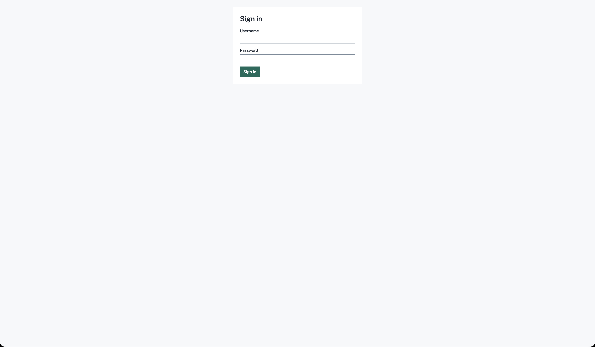
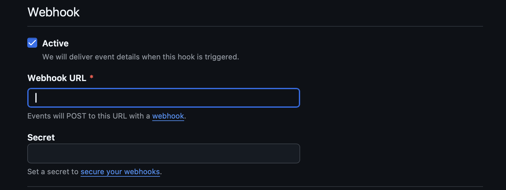
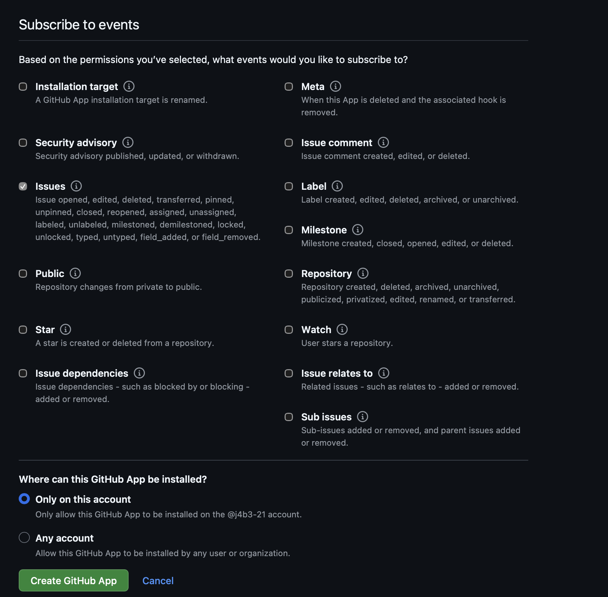

# IssueBot setup

Six steps. Each screenshot spot is marked with an HTML comment that includes the image path. Remove the comment markers once the image file exists.

You need: Docker Desktop, a GitHub account, a DocsGPT account.

---

## 1. Configure

```bash
cp .env.example .env
python3 -c "from cryptography.fernet import Fernet; print(Fernet.generate_key().decode())"
```

In `.env`, set:

| Key | Value |
| --- | --- |
| `ISSUEBOT_ADMIN_PASSWORD` | 12+ characters |
| `ISSUEBOT_FERNET_KEY` | output of the command above |
| `ISSUEBOT_DB_PASSWORD` | any password, also used in `ISSUEBOT_DATABASE_URL` |
| `ISSUEBOT_GITHUB_WEBHOOK_SECRET` | a long random string |
| `ISSUEBOT_ALLOWED_REPOS` | `owner/repo` |

---

## 2. Start

```bash
docker compose up --build
```

Open http://localhost:8080 and sign in as `admin`.

 

---

## 3. Open a tunnel

GitHub can't reach `localhost`.

```bash
brew install cloudflared
cloudflared tunnel --url http://localhost:8080
```

Copy the `https://….trycloudflare.com` address. It changes on every restart.

---

## 4. GitHub App

New app: https://github.com/settings/apps/new

| Field | Value |
| --- | --- |
| Webhook URL | `https://<tunnel>/api/v1/webhooks/github` |
| Webhook secret | same as `ISSUEBOT_GITHUB_WEBHOOK_SECRET` |
| Issues permission | Read and write |
| Events | Issues |


 

 

 

After creating the app:

1. Copy the **App ID**.
2. Click **Generate a private key** and save the `.pem` file.
3. Go to **Install App**, choose **Only select repositories**, and pick your repo.

---

## 5. DocsGPT agent

1. Go to https://app.docsgpt.cloud.
2. Add your docs as a source.
3. Create an agent with that source.
4. Copy the agent's **API key**.

---

## 6. IssueBot Settings

| Field | Value |
| --- | --- |
| DocsGPT base URL | `https://gptcloud.arc53.com` |
| DocsGPT API key | from step 5 |
| GitHub App ID | from step 4 |
| GitHub private key | full contents of the `.pem` file |

Click **Save changes**, then **Test DocsGPT** and **Test GitHub**.


---

## Try it

Open an issue in your repo. It appears under **Investigations** within seconds.


Publishing is off by default. To post a reply:

1. Turn on publishing in **Settings**.
2. Open the investigation.
3. Tick the review box.
4. Click **Publish comment**.

---

## If it doesn't work

Check your app's **Advanced → Recent Deliveries** on GitHub.


| You see | Fix |
| --- | --- |
| `401` | Webhook secret doesn't match `.env` |
| `202` with `repo_not_allowed` | Check `ISSUEBOT_ALLOWED_REPOS` |
| No delivery | Tunnel stopped or URL changed |
| Test GitHub fails | Wrong App ID or private key |
| Test DocsGPT fails | Wrong API key or base URL |

More: [docs/troubleshooting.md](docs/troubleshooting.md)
