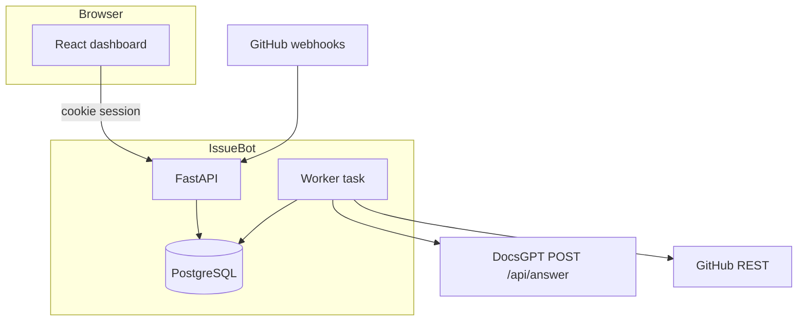
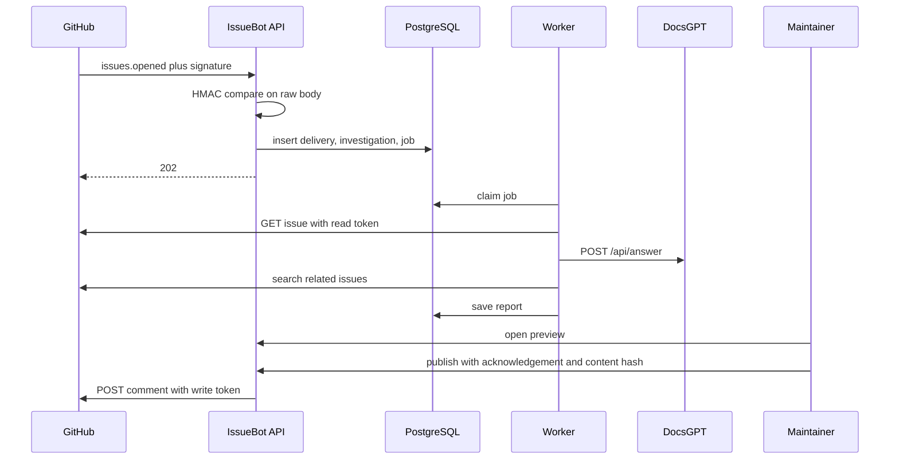

# Architecture

IssueBot is one FastAPI process, one PostgreSQL database, and one React app. The worker is an asyncio task in the API process. Jobs are rows in `investigation_jobs`. There is no Redis.

## Webhook to comment

## DocsGPT contract

Checked 2026-10-10 at [https://docs.docsgpt.cloud/API/agent-api](https://docs.docsgpt.cloud/API/agent-api). DocsGPT on GitHub main was version 1.0.0 that day. The docs pages used for this client were last updated 6–7 October 2026.

IssueBot sends JSON `question` and `api_key` to `{origin}/api/answer`. The key selects the agent. Redirects are not followed. The client reads `answer`, `sources`, `conversation_id`, and `tool_calls`. If `pending_tool_calls` is present, the job fails with `docsgpt_paused` because IssueBot does not approve tools. A `structured` object is preferred when DocsGPT sends one. Otherwise the answer text is parsed as JSON once. Source records are built only from the `sources` array. A URL that appears only in the model text is not a source.

Cloud agents are commonly reached at `https://gptcloud.arc53.com`. A local DocsGPT often listens on port 7091. That local URL is allowed only when private DocsGPT access is enabled or the process is not in production.

## GitHub contract

Checked 2026-10-10 against GitHub's REST and webhook documentation.

- Signature: HMAC-SHA256 of the raw body, header `X-Hub-Signature-256` = `sha256=` plus hex. Compared with `hmac.compare_digest`.
- Delivery id: `X-GitHub-Delivery`. The same id on a redelivery is an idempotent 202.
- App JWT: RS256, `iss` is the app id as a string, `iat` is now minus 60 seconds, `exp` is now plus 8 minutes.
- Installation token: `POST /app/installations/{id}/access_tokens`. The body limits permissions to Issues read or write and to one repository id when the call is about one repository.
- REST headers: `Accept: application/vnd.github+json`, `X-GitHub-Api-Version: 2026-03-10`, `User-Agent: IssueBot`.
- Comment: `POST /repos/{owner}/{repo}/issues/{number}/comments` with `{body}`. That call is not retried. A marker `<!-- issuebot:{investigation-uuid} -->` is included so a retry can find an existing comment.
- Installation events update local status for created, deleted, suspend, unsuspend, and new_permissions_accepted.

GitHub Search (`GET /search/issues`) may return 403 or 422 depending on the App's granted permissions. IssueBot records that failure on the report and continues.

## Persistence

Tables: `users`, `user_sessions`, `app_settings`, `github_installations`, `webhook_deliveries`, `investigations`, `investigation_jobs`, `audit_events`, `published_comments`. JSON columns are portable JSON, not JSONB, so the same models run on SQLite in tests. Installation tokens are not stored. Settings secrets are Fernet ciphertext.

## Job states

`queued` → `running` → `completed` or `failed`. A claim sets a 10-minute lease and increments attempts. Transient errors retry until `ISSUEBOT_JOB_MAX_ATTEMPTS` (default 5). Permanent errors stop. A maintainer can manually retry a failed investigation up to 3 times. HTTP calls happen after the claim transaction commits.

Display status `awaiting_approval` means completed and not yet published. `comment_published` means a GitHub comment id is stored.

## Errors

Integration failures use a fixed code. The client sees `safe_message(code)`, not the upstream body. Transient codes are timeouts, rate limits, unavailable, and network errors for both DocsGPT and GitHub. Publishing a comment is not in that retry loop.

## Decisions

- Postgres `FOR UPDATE SKIP LOCKED` claims the job. SQLite tests claim without that clause. One API process is the intended consumer.
- Password hashing is stdlib scrypt. No Argon2 dependency.
- CSRF is the custom header on cookie-authenticated mutations. The webhook path does not use that header.
- The public comment is rendered from the structured report and HTML-escaped. `@` is followed by a zero-width space so GitHub is less likely to notify a mention.
- Demo mode replaces DocsGPT and GitHub publish with fixtures and forces the publish switch off.
